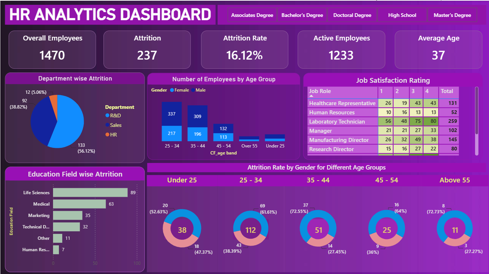

# 📊 HR Analytics Dashboard

## 📌 Project Overview
The HR Analytics Dashboard provides insights into employee data, attrition trends, workforce demographics, and job satisfaction to help HR teams make data-driven decisions.

## 🎯 Key Performance Indicators (KPIs)
- **Overall Employees:** Total number of employees.
- **Attrition Count:** Number of employees who left the organization.
- **Attrition Rate:** Percentage of employees who left.
- **Active Employees:** Number of currently active employees.
- **Average Age:** Average age of employees.

## 📈 Dashboard Insights
- Department-wise employee attrition
- Employee distribution by age group and gender
- Job satisfaction ratings by job role
- Attrition by education field
- Attrition rate by gender across different age groups
- Education-level filters for interactive analysis

## 🛠️ Tools Used
- Microsoft Excel
- Data Cleaning and Analysis
- Data Visualization
- Pivot Tables and Charts

## 💡 Business Objective
To identify employee attrition patterns, understand workforce demographics, evaluate job satisfaction, and help HR teams develop effective employee retention strategies.

## 📊 Key Findings
- Total Employees: 1,470
- Attrition Count: 237
- Attrition Rate: 16.12%
- Active Employees: 1,233
- Average Age: 37 years

## 🖼️ Dashboard Preview

## 👩‍💻 Author
Created as an HR Analytics project to demonstrate data analysis and dashboard visualization skills.
